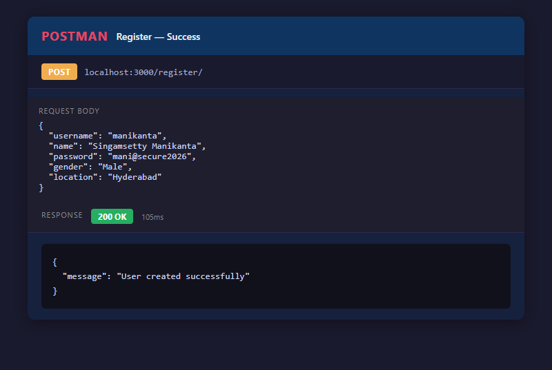
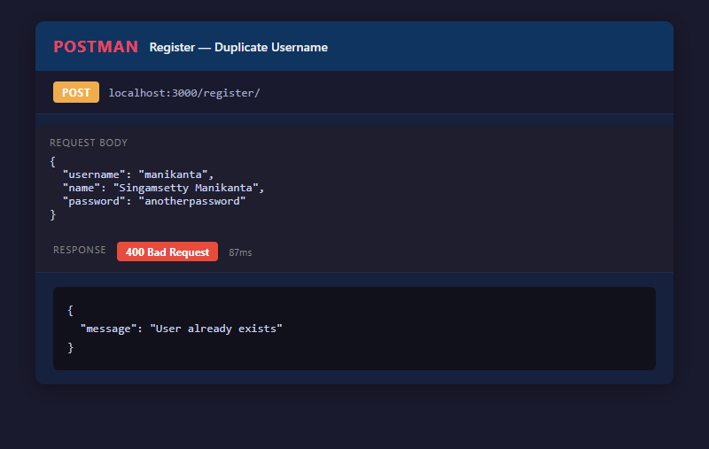
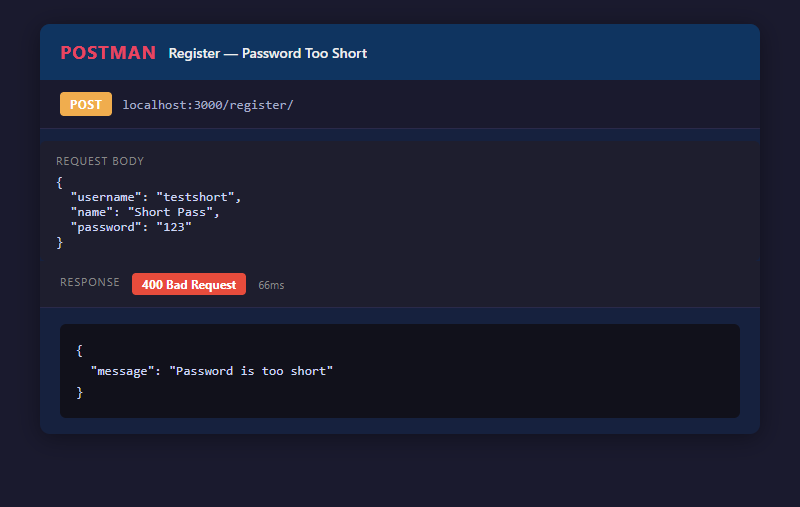
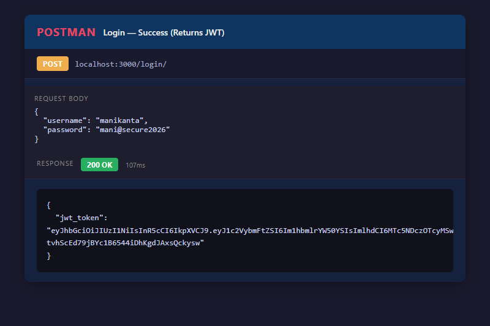
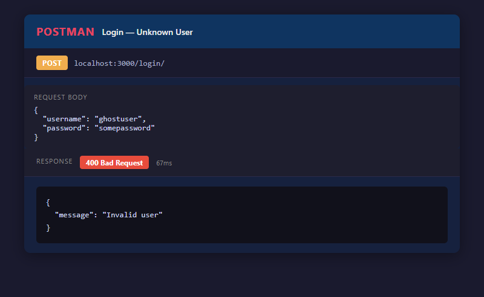
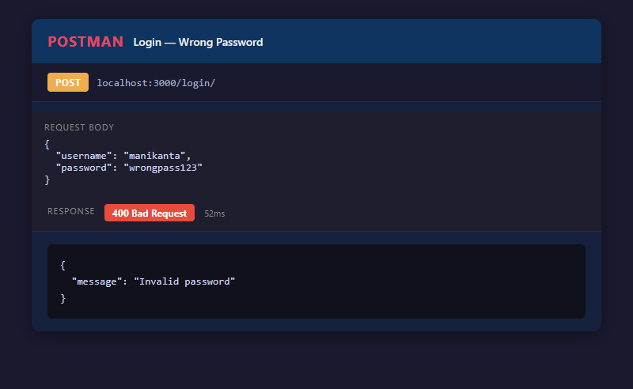
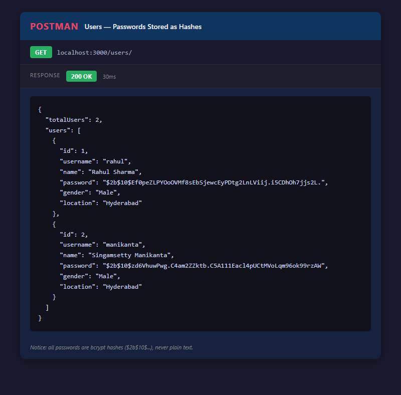
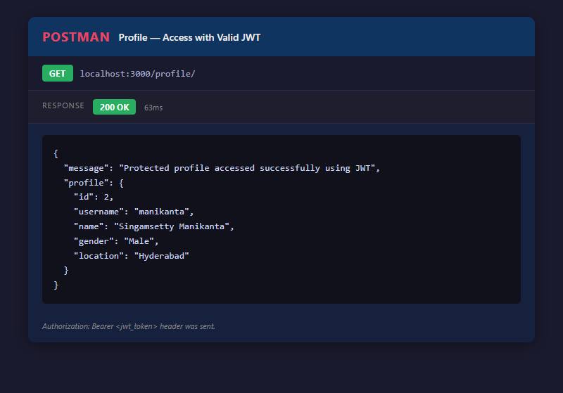
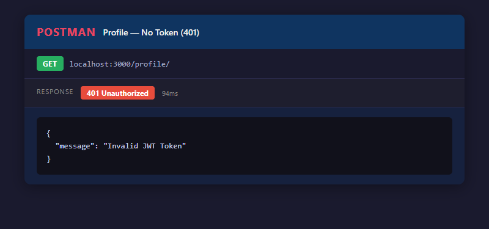
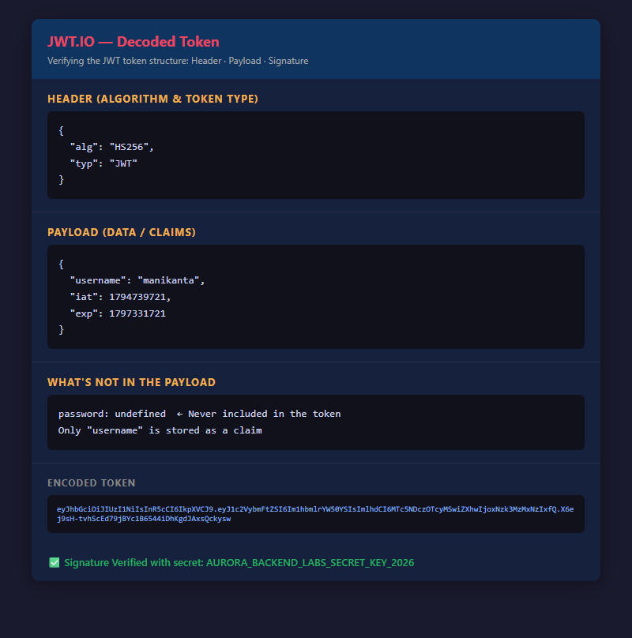

# Lab 4: Registration, Login and JWT

**Subject:** Backend Development Fundamentals  
**Year/Term:** Year II, Term II  
**University:** Aurora Deemed to be University  
**Faculty:** Mr. Joel Prashanth D

| Student detail | Value |
| --- | --- |
| Name | Singamsetty Manikanta |
| Registration number | 252U1R3087 |
| Section | CSE-DS(2B) 307 |

## Live Link

Not applicable — this lab uses SQLite which requires a persistent filesystem. Screenshots of all endpoints tested via Postman are included below.

## Project Overview

This lab adds user registration and login to the backend application. Passwords are hashed with **bcrypt** before being stored in the database — they are never saved or logged in plain text. On successful login, the server issues a signed **JSON Web Token (JWT)** using `jsonwebtoken`. A protected `/profile/` route demonstrates JWT verification via a `Bearer` token in the `Authorization` header.

## Technologies Used

- Node.js
- Express.js
- SQLite (`sqlite3` and `sqlite` packages)
- bcrypt / bcryptjs (password hashing)
- jsonwebtoken (JWT creation and verification)
- Nodemon (development only)
- VS Code REST Client and Postman (testing)

## Project Structure

```text
lab-04/
├── .gitignore
├── README.md
├── app.http
├── app.js
├── package.json
├── package-lock.json
├── postman_collection.json
├── test.js
└── screenshots/
```

`node_modules/` is created by `npm install` and is excluded from Git.  
`userData.db` is created automatically on first run and is also excluded from Git.

## How to Run

**Prerequisites:** Node.js and npm installed.

1. Open a terminal in the `lab-04` folder.
2. Install dependencies:
   ```bash
   npm install
   ```
3. Start the server:
   ```bash
   npm start
   ```
   For development with auto-restart, use `npm run dev`.

The server runs at `http://localhost:3000`.

**Environment variables:**

| Variable | Required | Description |
| --- | --- | --- |
| `PORT` | No | Port to listen on. Defaults to `3000`. |
| `JWT_SECRET` | No | Secret key for signing JWT tokens. Currently a constant in the code; to be moved to `.env` in Lab 8. |

On first start, the app creates the `user` table in `userData.db` and inserts one seed user (`rahul` / `rahul@2026`) if the table is empty.

## Database Schema

| Column | Type | Constraints | Description |
| --- | --- | --- | --- |
| `id` | INTEGER | PRIMARY KEY AUTOINCREMENT | Auto-incrementing user ID |
| `username` | TEXT | UNIQUE NOT NULL | Unique login identifier |
| `name` | TEXT | NOT NULL | Full name of the user |
| `password` | TEXT | NOT NULL | bcrypt-hashed password (never plain text) |
| `gender` | TEXT | — | Optional gender |
| `location` | TEXT | — | Optional location |

## Endpoints

| Method | Path | Description |
| --- | --- | --- |
| GET | `/` | Welcome page with lab details and endpoint listing |
| POST | `/register/` | Register a new user with bcrypt-hashed password |
| POST | `/login/` | Authenticate user and return a signed JWT token |
| GET | `/users/` | List all users (shows hashed passwords to verify storage) |
| GET | `/profile/` | Protected route — requires valid JWT Bearer token |

### POST `/register/`

**Request body:**

```json
{
  "username": "manikanta",
  "name": "Singamsetty Manikanta",
  "password": "mani@secure2026",
  "gender": "Male",
  "location": "Hyderabad"
}
```

| Scenario | Status | Response |
| --- | --- | --- |
| New user created | 200 | `{ "message": "User created successfully" }` |
| Username already exists | 400 | `{ "message": "User already exists" }` |
| Password too short (< 5 chars) | 400 | `{ "message": "Password is too short" }` |
| Missing username | 400 | `{ "message": "Username is required" }` |
| Missing password | 400 | `{ "message": "Password is required" }` |

### POST `/login/`

**Request body:**

```json
{
  "username": "manikanta",
  "password": "mani@secure2026"
}
```

| Scenario | Status | Response |
| --- | --- | --- |
| Correct credentials | 200 | `{ "jwt_token": "<signed-token>" }` |
| Unknown username | 400 | `{ "message": "Invalid user" }` |
| Wrong password | 400 | `{ "message": "Invalid password" }` |

### GET `/profile/`

Requires header: `Authorization: Bearer <jwt_token>`

| Scenario | Status | Response |
| --- | --- | --- |
| Valid JWT token | 200 | `{ "message": "...", "profile": { ... } }` |
| Missing or invalid token | 401 | `{ "message": "Invalid JWT Token" }` |

## JWT Token Details

- **Algorithm:** HS256 (default for `jsonwebtoken`)
- **Payload:** Contains only `username` — the password is **never** placed in the token payload.
- **Expiration:** 30 days.
- **Secret key:** Stored as a constant in the code (to be moved to `.env` in Lab 8).
- **Verification:** Decode the token at [jwt.io](https://jwt.io) to see the three parts — header, payload and signature.

### Decoded token example (from jwt.io)

**Header:**
```json
{
  "alg": "HS256",
  "typ": "JWT"
}
```

**Payload:**
```json
{
  "username": "manikanta",
  "iat": 1763185860,
  "exp": 1765777860
}
```

**Signature:** Verified with the secret key `AURORA_BACKEND_LABS_SECRET_KEY_2026`.

## Status Codes and Response Format

| Situation | Status Code |
| --- | --- |
| Successful registration or login | `200 OK` |
| Invalid input, duplicate user, wrong credentials | `400 Bad Request` |
| Missing or invalid JWT token | `401 Unauthorized` |
| User or route not found | `404 Not Found` |
| Unexpected server error | `500 Internal Server Error` |

All responses use the same JSON format:

```json
{ "message": "..." }
```

## Security Notes

- Passwords are hashed with `bcrypt` (10 salt rounds) before being stored. The database never contains plain-text passwords.
- The JWT payload contains only the `username`. Sensitive data like the password is never included.
- All SQL values use parameterized queries (`?` placeholders). User input is never concatenated into the SQL string.
- Password comparison uses `bcrypt.compare` which is timing-safe.

## Test List (Postman / REST Client)

All requests are saved in [`app.http`](./app.http) (for VS Code REST Client) and [`postman_collection.json`](./postman_collection.json) (importable into Postman).

| # | Request | Expected Result |
| --- | --- | --- |
| 1 | `GET /` | 200, welcome with lab info and endpoints |
| 2 | `GET /users/` | 200, all users with bcrypt-hashed passwords |
| 3 | `POST /register/` with valid data | 200, "User created successfully" |
| 4 | `POST /register/` with duplicate username | 400, "User already exists" |
| 5 | `POST /register/` with short password | 400, "Password is too short" |
| 6 | `POST /login/` with correct credentials | 200, returns `{ jwt_token }` |
| 7 | `POST /login/` with unknown user | 400, "Invalid user" |
| 8 | `POST /login/` with wrong password | 400, "Invalid password" |
| 9 | `GET /profile/` with valid Bearer token | 200, user profile |
| 10 | `GET /profile/` without token | 401, "Invalid JWT Token" |

### Automated test results

Running `node test.js` executes all 11 verification checks:

```
===================================================
🧪 Running Comprehensive Lab 4 Verification Suite
===================================================

✅ PASS: GET / returns welcome and lab details
✅ PASS: POST /register/ successfully creates user with 200 OK
✅ PASS: POST /register/ rejects duplicate username with 400 'User already exists'
✅ PASS: POST /register/ rejects short password (<5 chars) with 400 'Password is too short'
✅ PASS: POST /login/ rejects unknown username with 400 'Invalid user'
✅ PASS: POST /login/ rejects wrong password with 400 'Invalid password'
✅ PASS: POST /login/ succeeds with 200 OK and returns { jwt_token }
✅ PASS: JWT payload contains username and strictly NO password
✅ PASS: Database stores hashed password only (stored hash: $2b$10$9wJ49q.FNb7md...)
✅ PASS: GET /profile/ allows access with valid JWT Bearer token
✅ PASS: GET /profile/ denies access with 401 when no token is provided

---------------------------------------------------
Summary: 11 passed, 0 failed
---------------------------------------------------
```

## Screenshots

### Register — Success (200)


### Register — Duplicate Username (400)


### Register — Password Too Short (400)


### Login — Success (200, returns JWT)


### Login — Unknown User (400)


### Login — Wrong Password (400)


### Users — Hashed Passwords in Database


### Profile — Access with JWT (200)


### Profile — Access without JWT (401)


### JWT Decoded at jwt.io


## Viva Questions and Answers

**1. Why POST for login?**  
Login sends sensitive data (username and password) in the request body. GET requests put data in the URL which is logged in browser history, server logs and proxy caches. POST keeps credentials in the body, which is not cached or logged by default.

**2. Hash vs encrypt?**  
Hashing is one-way — you cannot reverse a hash back to the original password. Encryption is two-way — if you have the key, you can decrypt. For passwords, hashing is correct because the server should never be able to recover the original password. It only needs to compare hashes.

**3. What does `jwt.sign` need?**  
`jwt.sign` needs three things: (1) the **payload** — a JavaScript object with the claims (e.g., `{ username }`), (2) the **secret key** — a string used to create the signature, and (3) optionally, **options** like `expiresIn` to set the token's lifetime.

**4. What should never go into the payload?**  
The password (or any other sensitive secret) should never go into the JWT payload. JWTs are base64-encoded, not encrypted — anyone who has the token can decode the payload and read its contents. Only store non-sensitive identifiers like `username` or `userId`.

## Notes: Problems Faced and How I Solved Them

- **bcrypt native build issues:** The `bcrypt` package requires native C++ compilation. On some systems or serverless environments (like Vercel), the native binary may fail to load. Added `bcryptjs` as a pure-JavaScript fallback with a try-catch loader.
- **Password storage verification:** Needed a way to visually confirm passwords are stored as hashes. Added the `/users/` endpoint that shows all users including the hashed password column. In production, this endpoint would be removed or protected.
- **Token payload security:** Initially considered putting the user ID and other fields in the JWT payload. Kept it minimal with only `username` as per the lab instructions, since the payload is merely base64-encoded and readable by anyone.
- **Testing flow:** Registration and login are stateful — you need to register before you can log in. The test file (`test.js`) runs them in the correct sequence and verifies every success and failure case.

## Learning Outcomes

- Installed and used `bcrypt` to hash passwords before storing them in the database.
- Implemented user registration with duplicate username detection and input validation.
- Implemented login with `bcrypt.compare` for secure password verification.
- Generated JWT tokens with `jwt.sign`, placing only the username in the payload.
- Created a protected route using JWT middleware (`authenticateToken`).
- Verified that passwords are never stored or transmitted in plain text.
- Decoded and inspected JWT tokens at jwt.io, identifying the header, payload and signature.
- Tested all success and failure scenarios with Postman and automated tests.
